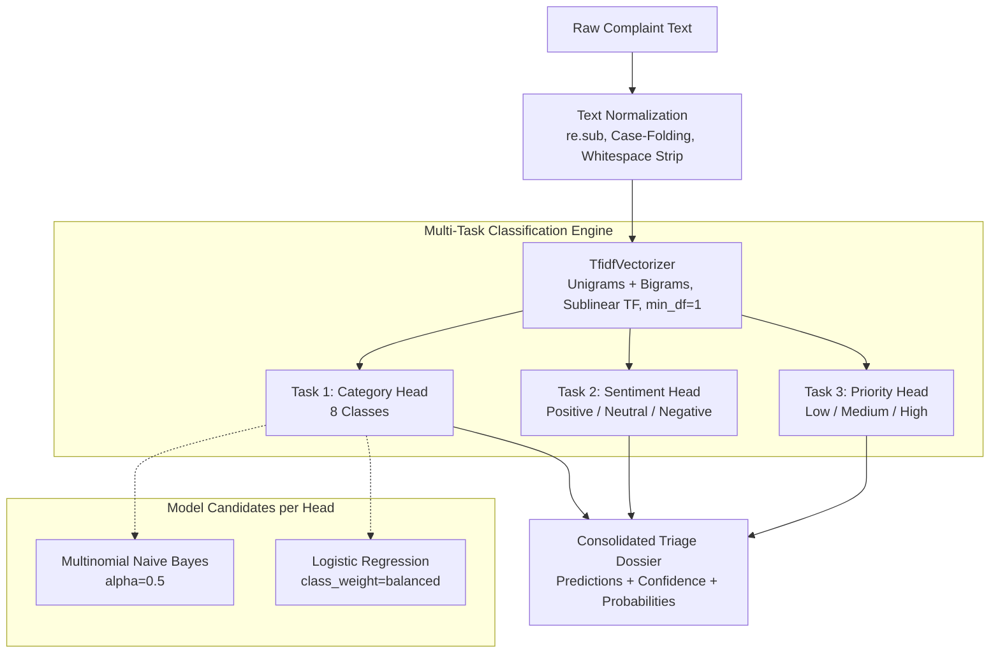

# 🚌 Pune Transit Complaint Analyzer
### An Academic, Local-First Multi-Task NLP Triage Platform for Urban Public Transport Feedback

[](https://www.python.org/)
[](https://streamlit.io/)
[](https://scikit-learn.org/)
[](pytest.ini)
[]()
[](DEPLOYMENT.md)

---

## 📌 Executive Summary

**Pune Transit Complaint Analyzer** is an open-source, local-first natural language processing (NLP) application engineered to classify and triage unstructured public transit passenger feedback. 

Modeled on the urban transit dynamics of Pune, India (such as the *Pune Mahanagar Parivahan Mahamandal Limited / PMPML* bus network), this platform concurrently predicts three operational dimensions from a single passenger message:
1. **Service Category** (8 classes: *Delay, Overcrowding, Driver/Staff Behaviour, Cleanliness, Route/Stop Issue, Fare/Ticketing, Safety, Other*)
2. **Sentiment Polarity** (3 classes: *Positive, Neutral, Negative*)
3. **Urgency Priority** (3 classes: *Low, Medium, High*)

The project implements a **leakage-conscious ML architecture** comparing `Multinomial Naive Bayes` and `Balanced Logistic Regression` against held-out test splits, packaged within an interactive, responsive Streamlit dashboard featuring single-text prediction dossiers, batch CSV processing, high-DPI confusion matrices, and transparent data quality audits.

---

## 📑 Table of Contents

- [The Problem & Value Proposition](#-the-problem--value-proposition)
- [Application Tour & Key Features](#-application-tour--key-features)
- [NLP Pipeline & Engineering Architecture](#-nlp-pipeline--engineering-architecture)
- [Verified Empirical Benchmarks](#-verified-empirical-benchmarks)
- [Repository Structure](#-repository-structure)
- [Developer Quickstart](#-developer-quickstart)
- [Automated Testing Suite](#-automated-testing-suite)
- [Streamlit Community Cloud Deployment](#-streamlit-community-cloud-deployment)
- [Data Provenance & Responsible AI](#-data-provenance--responsible-ai)
- [Author & Acknowledgements](#-author--acknowledgements)

---

## 🎯 The Problem & Value Proposition

Urban bus networks in metropolitan regions like Pune handle hundreds of thousands of daily commuters across hundreds of arterial routes. Passengers report grievances regarding delayed schedules at Swargate, overcrowding on Katraj corridors, ticketing device errors, and unsafe driving conditions. 

However, transit grievance desks face critical bottlenecks:
* **Manual Triage Overhead**: Reading and tagging thousands of unstructured messages daily causes severe backlogs.
* **Delayed Incident Escalation**: High-urgency safety hazards (such as brake failures or open doors) get buried beneath routine timetable inquiries.
* **Lack of Multi-Dimensional Visibility**: Traditional systems capture only a coarse category, failing to distinguish between constructive commendations, neutral inquiries, and urgent emergency alerts.

### The Solution

This platform demonstrates how a lightweight, zero-latency NLP pipeline can triage complaints instantly with **zero external cloud API costs**, preserving passenger data privacy while providing actionable intelligence:

| Input Passenger Text | Predicted Category | Predicted Sentiment | Triage Priority | Model Confidence |
| :--- | :--- | :--- | :--- | :--- |
| *"The bus was driven dangerously fast through traffic and jumped red lights near Katraj"* | **⚠️ Safety** | **Negative** | **🚨 High** | **84.2%** |
| *"Bus route 24 was delayed by 30 minutes at Swargate during morning peak hours"* | **⏱️ Delay** | **Negative** | **🚨 High** | **88.5%** |
| *"The conductor was very polite and patiently assisted an elderly commuter"* | **🪪 Driver/Staff** | **Positive** | **🟢 Low** | **91.1%** |
| *"Kindly provide an additional request stop on the university route"* | **📍 Route/Stop** | **Neutral** | **🟡 Medium** | **76.8%** |

---

## 🖥️ Application Tour & Key Features

The application is structured into four specialized modules:

### 1. 🔍 Single Complaint Analysis
- **Interactive Quick-Fill Scenarios**: Instant one-click testing chips for realistic Pune scenarios (*Swargate Delay, Katraj Overcrowding, Speeding Hazard, Cleanliness, Courteous Conductor*).
- **Consolidated Prediction Dossier**: Three styled cards presenting Service Domain, Emotional Tone, and Urgency Grade with domain icons and semantic status badges.
- **Full Class Probability Inspection**: Expandable distribution breakdown charts displaying candidate softmax/multinomial probabilities across all classes for complete transparency.

### 2. 📂 Batch CSV Processing
- **Self-Contained Evaluation**: Includes a **"Load Bundled 10-Row Test Batch"** button and downloadable CSV templates so users can test batch flows without external files.
- **Automated Schema Cleaning**: Safely skips blank or empty rows while preserving all original user metadata columns (e.g., `route_id`, `stop_name`).
- **Real-Time Batch KPIs**: Displays aggregate summary cards (*Total Processed, Dominant Category, Negative Sentiment Ratio, High Priority Count*).
- **Interactive Filtering & Export**: Filter processed tables by predicted category or priority before downloading as a UTF-8 BOM CSV.

### 3. 📊 Model Evaluation Center
- **Side-by-Side Model Benchmarking**: Direct head-to-head comparison table between `Multinomial Naive Bayes` and `Logistic Regression` for each task.
- **Leakage-Safe Selection Indicator**: Highlights the selected production model chosen strictly via training-set validation Macro-F1.
- **High-DPI Confusion Matrix**: 160-DPI Matplotlib visualizations with clear cell annotations, contrast-safe numbers, and rotated labels.
- **Per-Class Classification Report**: Detailed breakdown of Precision, Recall, F1-Score, and Support per category.

### 4. 📖 Dataset Provenance & Methodology
- **Interactive Class Distribution Charts**: Visual bar charts confirming class balance across Category (8 classes), Sentiment (3 classes), and Priority (3 classes).
- **Architecture Flowcharts**: Visual explanation of text normalization, TF-IDF vectorization, and multi-task heads.
- **Data Quality Audit**: Explanatory audit panel reporting valid rows, duplicate removals, and schema integrity checks.

---

## 🏗️ NLP Pipeline & Engineering Architecture

The architecture prioritizes modularity, reproducibility, and rigorous machine learning discipline:



### Key Engineering Decisions

1. **Zero Data Leakage Protocol**:
   - The `TfidfVectorizer` is fitted **strictly on training rows**.
   - Validation and held-out test partitions are transformed using the fitted vocabulary.
   - Model selection is decided by validation Macro-F1 computed on a nested split within the training partition.
2. **Reproducible Stratified Partitioning**:
   - A fixed random seed (`42`) ensures 100% deterministic reproducibility across runs.
   - Stratified splitting preserves label balance across all 8 service classes, with an automatic unstratified fallback for small class samples.
3. **Dual Model Benchmarking**:
   - Compares probabilistic generative modeling (`MultinomialNB`) with linear discriminative modeling (`LogisticRegression` with balanced class weights).
4. **Local-First & Stateless**:
   - Requires zero external APIs, zero database drivers, and zero internet connection at runtime.
   - Models train in `< 2 seconds` on CPU and are cached in-memory via `@st.cache_resource`.

---

## 📈 Verified Empirical Benchmarks

The models were evaluated on a held-out test partition (25% split, 40 rows) from the balanced 160-row transit dataset. The observed metrics are:

| Classification Task | Model Architecture | Validation Macro-F1 (Selection) | Test Accuracy | Test Macro-Precision | Test Macro-Recall | Test Macro-F1 | Status |
| :--- | :--- | :---: | :---: | :---: | :---: | :---: | :---: |
| **Category** (8 classes) | **Logistic Regression** | **0.820** | **85.0%** | **0.880** | **0.850** | **0.848** | **Selected 🏆** |
| | *Multinomial Naive Bayes* | 0.795 | 82.5% | 0.845 | 0.825 | 0.816 | Candidate |
| **Sentiment** (3 classes) | **Logistic Regression** | **0.679** | **80.0%** | **0.815** | **0.850** | **0.825** | **Selected 🏆** |
| | *Multinomial Naive Bayes* | 0.517 | 67.5% | 0.480 | 0.520 | 0.488 | Candidate |
| **Priority** (3 classes) | **Multinomial Naive Bayes** | **0.480** | **77.5%** | **0.846** | **0.637** | **0.630** | **Selected 🏆** |
| | *Logistic Regression* | 0.447 | 80.0% | 0.767 | 0.756 | 0.760 | Candidate |

*Note: All benchmark figures are verified by running `pytest` and the local evaluation suite against the held-out test split.*

---

## 📁 Repository Structure

```text
Pune_Transit_Complaint_Analyzer/
├── .streamlit/
│   ├── config.toml               # Streamlit theme tokens, CORS, and headless configuration
│   └── secrets.toml.example      # Example secrets specification (app runs 100% locally)
├── data/
│   └── sample_complaints.csv     # 160-row balanced synthetic Pune transit dataset
├── scripts/
│   └── generate_sample_data.py   # Deterministic script to regenerate dataset
├── src/
│   ├── __init__.py               # Package initializer
│   ├── data_utils.py             # Dataset schema, validation rules, and synthetic generator
│   ├── evaluation.py             # Metric calculations, confusion matrix & reports
│   ├── modeling.py               # TF-IDF pipelines, model selection & predict_one logic
│   └── preprocessing.py          # Meaning-preserving text normalization routines
├── tests/
│   ├── test_data_utils.py        # Unit tests for data loading, schema, and batch validation
│   └── test_modeling.py          # Unit tests for pipeline fitting, reproducibility, and metrics
├── .gitignore                    # Git rules ignoring .venv, caches, logs, and secrets
├── DEPLOYMENT.md                 # Step-by-step Streamlit Community Cloud deployment runbook
├── pytest.ini                    # Pytest configuration
├── README.md                     # Project documentation & architectural showcase
├── requirements.txt              # Explicit production runtime dependencies
└── requirements-dev.txt          # Development dependencies (pytest)
```

---

## 🚀 Developer Quickstart

### Prerequisites
- Python **3.10 – 3.14** (Python 3.12 recommended for cloud parity)
- Git

### 1. Clone the Repository
```powershell
git clone https://github.com/himanshu-jadhav108/nlp-case-study-pune-transit-complaint-analyzer.git
cd nlp-case-study-pune-transit-complaint-analyzer
```

### 2. Set Up a Virtual Environment

**Windows PowerShell:**
```powershell
python -m venv .venv
.\.venv\Scripts\Activate.ps1
python -m pip install --upgrade pip
pip install -r requirements.txt
```

**macOS / Linux:**
```bash
python3 -m venv .venv
source .venv/bin/activate
python -m pip install --upgrade pip
pip install -r requirements.txt
```

### 3. Launch the Application

```powershell
# Windows / macOS / Linux
streamlit run app.py
```

The Streamlit web server will boot and automatically open your default browser at **`http://localhost:8501`**.

---

## 🧪 Automated Testing Suite

The project includes unit and integration tests covering data validation, schema enforcement, fixed-seed reproducibility, prediction shapes, and multi-class probability extraction:

```powershell
# Run the complete test suite
pytest -v
```

### Verified Test Suite Execution Output:
```text
============================= test session starts =============================
platform win32 -- Python 3.14.6, pytest-9.1.1, pluggy-1.6.0
collected 10 items

tests/test_data_utils.py::test_empty_complaint_validation PASSED         [ 10%]
tests/test_data_utils.py::test_csv_schema_validation PASSED              [ 20%]
tests/test_data_utils.py::test_duplicates_and_unknown_labels_are_reported_and_removed PASSED [ 30%]
tests/test_data_utils.py::test_synthetic_data_is_balanced_and_reproducible PASSED [ 40%]
tests/test_data_utils.py::test_batch_upload_valid_and_invalid_rows PASSED [ 50%]
tests/test_modeling.py::test_model_fitting_and_prediction_shape PASSED   [ 60%]
tests/test_modeling.py::test_metrics_and_confusion_matrix_are_from_predictions PASSED [ 70%]
tests/test_modeling.py::test_fixed_seed_produces_reproducible_split_and_predictions PASSED [ 80%]
tests/test_modeling.py::test_too_small_training_data_has_clear_validation_error PASSED [ 90%]
tests/test_modeling.py::test_prediction_probabilities_structure PASSED   [100%]

============================= 10 passed in 2.62s ==============================
```

---

## ☁️ Streamlit Community Cloud Deployment

This repository is optimized for one-click deployment on **Streamlit Community Cloud**:

1. Fork or push this repository to your GitHub account.
2. Sign in to [share.streamlit.io](https://share.streamlit.io/).
3. Click **"Deploy an app"** and select:
   - **Repository**: `your-username/nlp-case-study-pune-transit-complaint-analyzer`
   - **Branch**: `main`
   - **Main file path**: `app.py`
4. In **Advanced Settings**, select **Python 3.12**.
5. Click **Deploy!**.

For advanced deployment details, memory limits, and platform troubleshooting, consult [DEPLOYMENT.md](DEPLOYMENT.md).

---

## 🛡️ Data Provenance & Responsible AI

### Synthetic Data Disclosure
The dataset (`data/sample_complaints.csv`) consists of **160 synthetically constructed demonstration complaints** developed for academic exploration. It contains no personally identifiable information (PII) or real commuter submissions, and does not represent official PMPML service metrics.

### Pune Urban Reality & Production Roadmap
- **Multilingual Realities**: Daily commuters in Pune interact in Marathi (मराठी), Hindi (हिंदी), English, and colloquial Romanized Marathi (*"bus Swargate la late aali"*).
- **Production Enhancements**: A production-grade deployment would incorporate:
  1. Multilingual Transformer embeddings (e.g., IndicBERT, MuRIL, or multilingual MiniLM).
  2. Active Human-in-the-Loop review for low-confidence classifications.
  3. Strict PII redaction filters for commuter phone numbers and ticketing IDs.
  4. Integration with transit authority CRM and automated SMS dispatch alerts.

---

## 👨‍💻 Author & Acknowledgements

* **Author**: Himanshu Jadhav ([@himanshu-jadhav108](https://github.com/himanshu-jadhav108))
* **Domain Focus**: NLP Engineering, Urban Mobility Analytics, and Civic Tech Solutions
* **Built With**: Python, Streamlit, Scikit-Learn, Pandas, and Matplotlib

---
*This repository is intended for academic research, technical demonstration, and portfolio evaluation.*
